# Loom

https://www.loom.com/share/abf88979c4a742a19154360b6d6944e5
https://www.loom.com/share/f00fa95e3f21459f8423cbcb5f526939 (small comment additionaly to main loom)

# Forge

> **Loom walkthrough:** _link coming with the final submission_

Forge is a private training companion: sign up, pick your goals, and work through a
three-session plan that unlocks in order — Foundation, Build, Forge. Progress lives on the
server, so the order can't be skipped and survives a reinstall; a cached copy makes a cold
launch paint instantly. A coach chat, behind a mocked paywall, answers with your name, goals
and progress. After onboarding it asks — one screen each — for notifications, usage analytics
and, on iOS, tracking; analytics is a mock and strictly opt-in.

## Prerequisites

- Node 24 via nvm (`nvm use` reads `.nvmrc`)
- pnpm 10 via corepack (`corepack enable`; the repo pins `pnpm@10.34.5`)
- Docker (for Postgres 16)
- Xcode with an iOS Simulator (or an Android emulator) and Expo Go — Expo CLI installs Expo Go
  on the simulator for you

## Quick start

```bash
pnpm i
docker compose up -d --wait
cp apps/api/.env.example apps/api/.env
pnpm db:push
pnpm dev:api      # in one terminal
pnpm dev:mobile   # in another, then press i
```

`pnpm db:push` applies the Drizzle schema directly (`drizzle-kit push`). With one schema
version and no production data, migration files would add nothing; a real deployment would
switch to `drizzle-kit generate` + `migrate`.

## Running on a device

Set `EXPO_PUBLIC_API_URL` in `apps/mobile/.env` (copy `apps/mobile/.env.example`):

- iOS Simulator: `http://localhost:3000` (the default)
- Android emulator: `http://10.0.2.2:3000`
- Phone on the same Wi-Fi: `http://<your computer's LAN IP>:3000` — the API listens on
  `0.0.0.0`

At SDK 57's launch, the App Store build of Expo Go lagged behind the SDK. If your phone's Expo
Go can't open the project, use `eas go` or the simulator.

## Tests

```bash
pnpm test        # contracts smoke test, API unit tests, and the mobile analytics core (node:test)
pnpm test:e2e    # API end-to-end against the docker-compose Postgres (forge_test)
```

Mobile: screens have no automated tests by design (TDD exemption); only the analytics consent
gate is unit-tested. Each screen was checked in the iOS Simulator (iPhone 16), and sign-in,
onboarding and the Plan also on an Android emulator; the permission steps and analytics were
checked on iOS only. See the screenshots.

API details (endpoints, env vars, structure): [apps/api/README.md](apps/api/README.md).
Mobile details (running it, structure): [apps/mobile/README.md](apps/mobile/README.md).

## Screenshots

All from an iPhone 16 simulator; the full set is in [`docs/screenshots/`](docs/screenshots/).

| | |
| --- | --- |
| **Sign in**<br>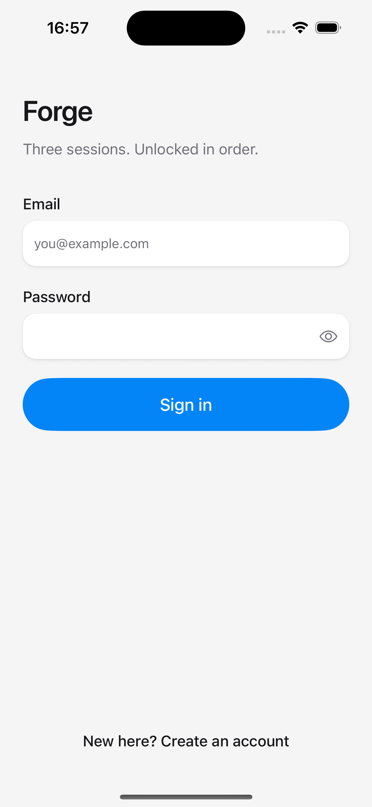 | **Onboarding**<br>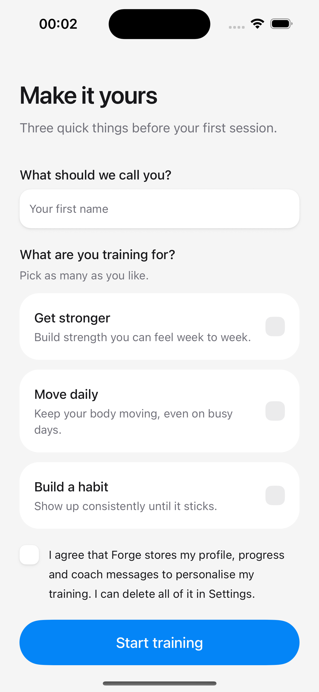 |
| **Plan**<br>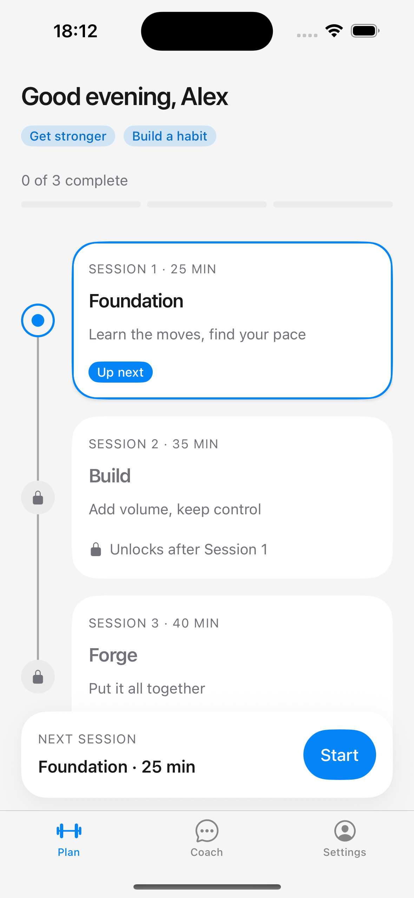 | **Session, ready to complete**<br>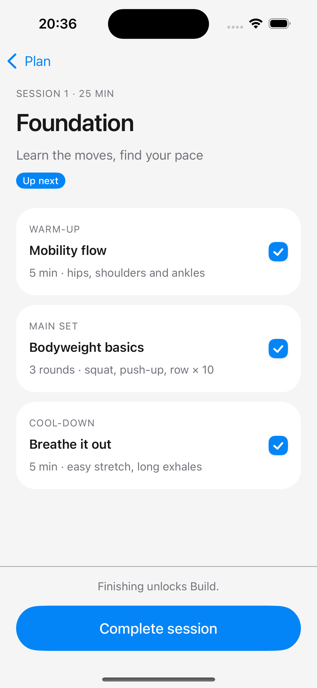 |
| **Plan complete**<br>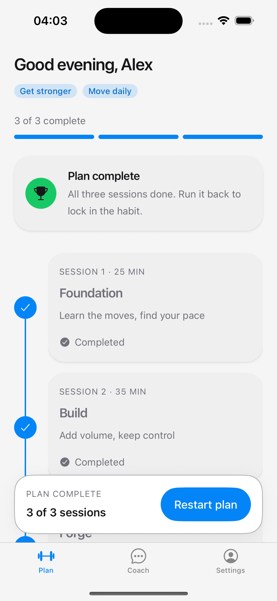 | **Coach chat**<br>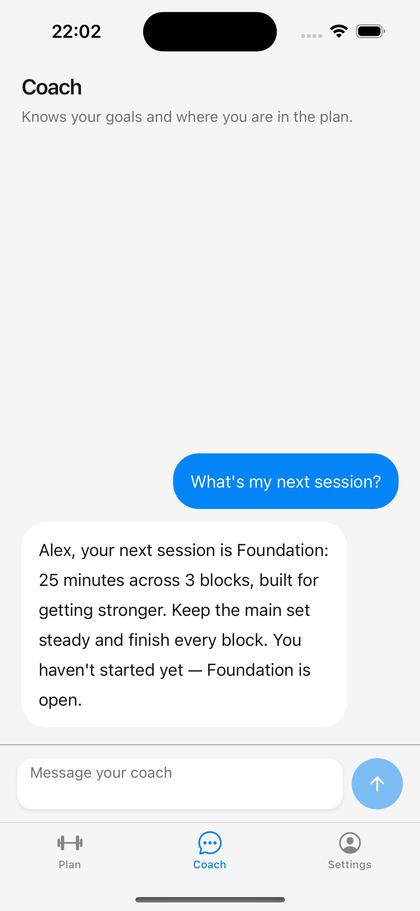 |
| **Paywall**<br>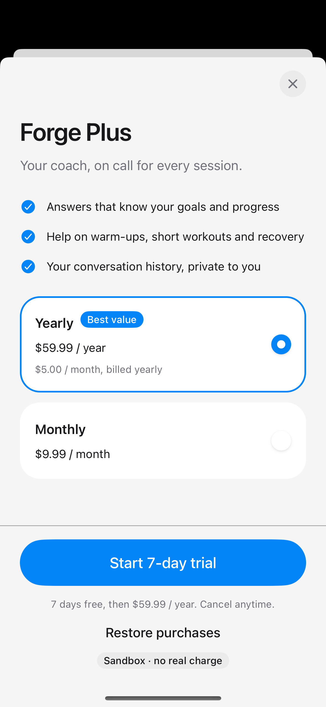 | **Settings**<br>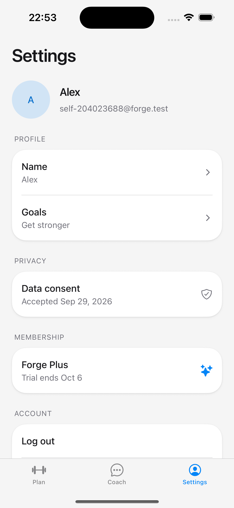 |
| **Permission step**<br>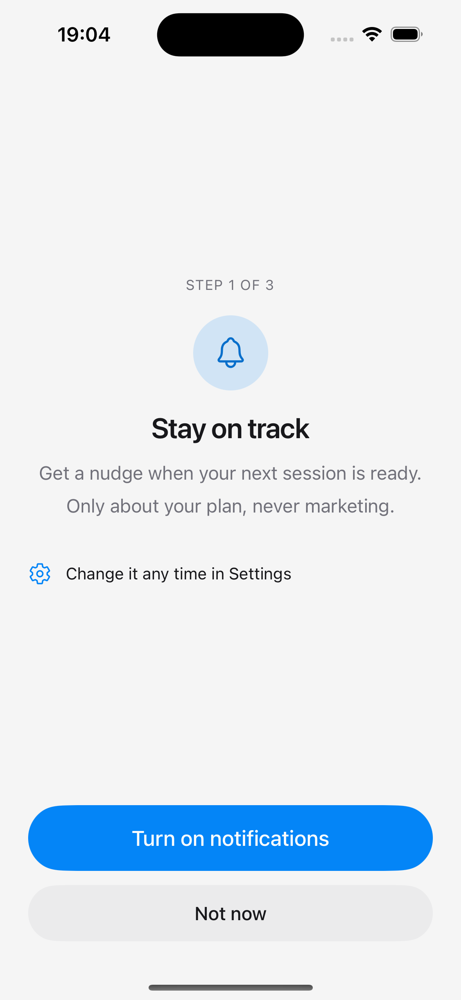 | **Privacy settings**<br>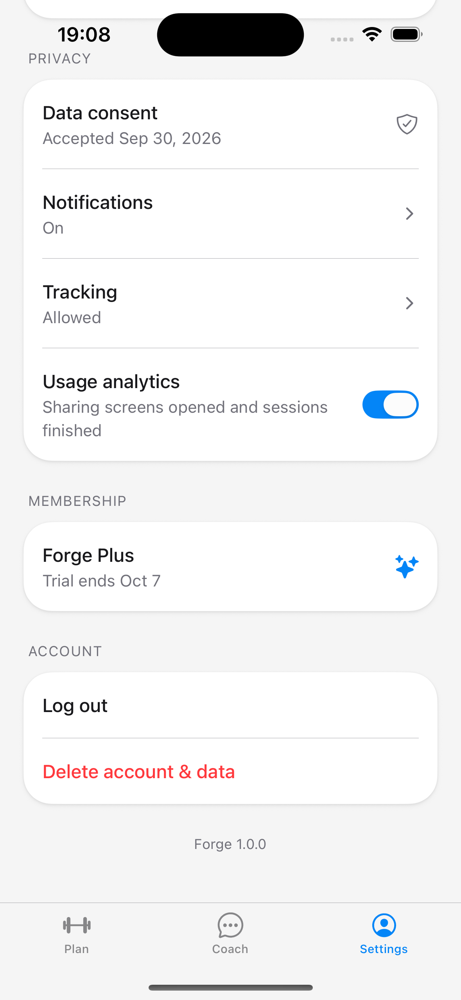 |
| **Plan (dark)**<br>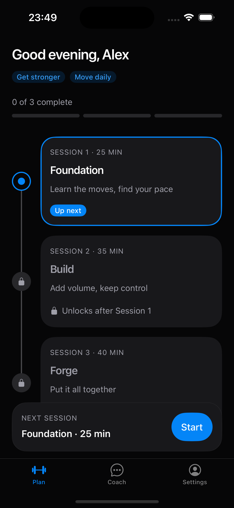 | **Coach chat (dark)**<br>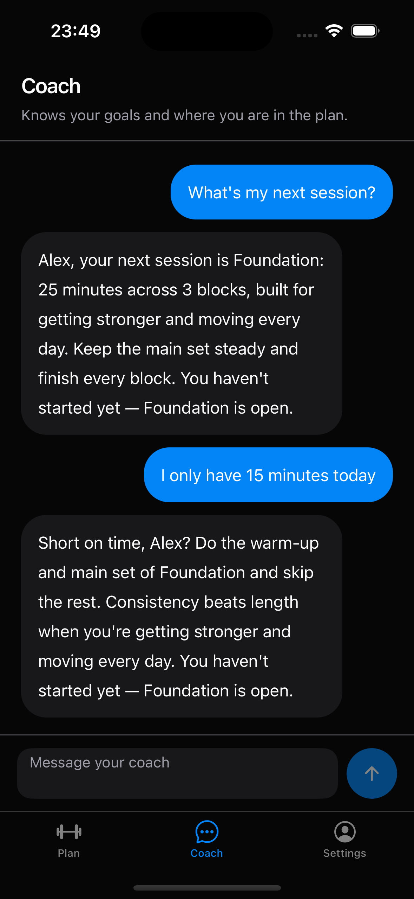 |

## Architecture

- `packages/contracts` — the only shared code: domain types, zod schemas (with the user-facing
  validation copy) and route constants.
- `apps/api` — NestJS 11. Each module is controller → service → repository port → Drizzle
  adapter; services are unit-tested against in-memory adapters. Postgres 16 via Drizzle.
- `apps/mobile` — Expo SDK 57, Expo Router, HeroUI Native + Uniwind, TanStack Query (plan and
  profile persisted for an instant cold start) and Zustand (JWT in SecureStore). Permission steps and a mock, opt-in analytics layer
  (`src/lib/analytics`) cover the funnel.
- Design: [`docs/superpowers/specs/2026-09-28-forge-design.md`](docs/superpowers/specs/2026-09-28-forge-design.md).
  Rulings made while building: [`docs/decisions/`](docs/decisions/).

## What I'd change with one more hour

- On the headerless tab screens (Plan, Settings) the content scrolls straight under the
  status-bar clock. A fading top edge or a collapsing title would keep the clock legible
  while scrolling.
- Toasts appear at the top and, for the few seconds they show, sit over the controls there:
  the session screen's back button and the paywall's close button. Placing them below the header
  on those screens would keep navigation within reach while the message shows.
- Tapping "Start training" on an empty onboarding form grows every field with its error and
  pushes the button below the fold. Scrolling to the first invalid field on submit would keep
  the person looking at what needs fixing instead of at a half-hidden button.
